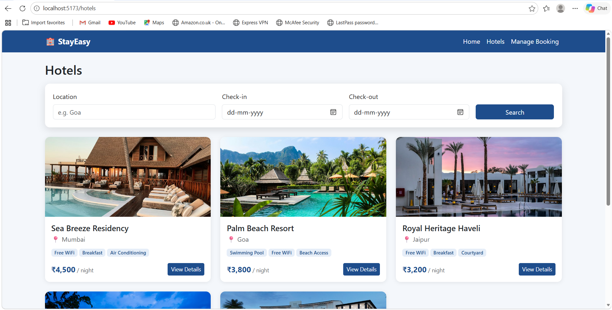
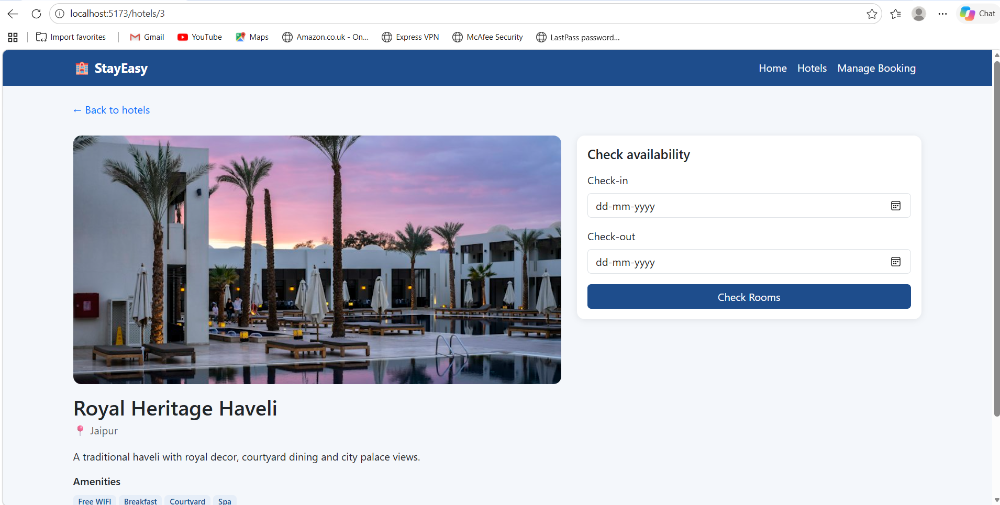
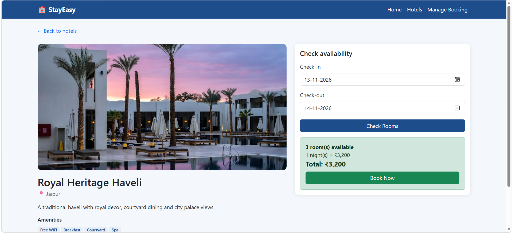
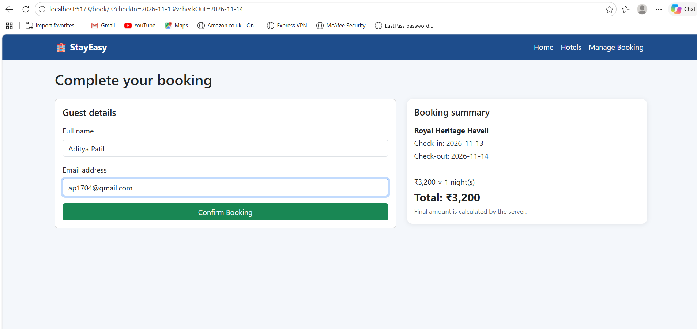
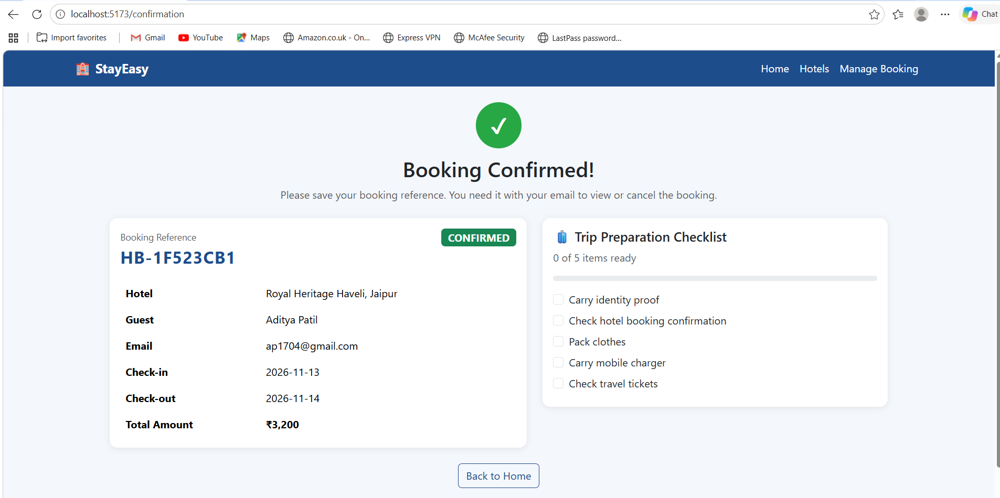

# StayEasy – Hotel Booking Portal

## 1. Project Overview
A simple hotel booking website. Customers can browse hotels, search by location and dates, see the total price, book a room, retrieve a booking using reference + email, and cancel it. No login is needed.

## 2. Objectives
- Build a full-stack app with React, Spring Boot and MySQL.
- Keep the code simple, layered and easy to explain.
- Keep room availability correct (no overbooking).

## 3. Features
- Browse 5 sample hotels (name, location, description, amenities, price per night)
- Search by location (and optionally by dates; only hotels with a free room are shown)
- Hotel details page and availability check for selected dates
- Booking with name and email; total shown before confirming (calculated by the backend)
- Unique booking reference (example `HB-3F9A1C7D`)
- Retrieve booking with reference + email
- Cancel booking (rooms are released)
- Validation messages and consistent JSON error responses
- **Surprise feature:** Trip Preparation Checklist

## 4. Technology Stack
React (Vite), React Router, Axios, Bootstrap + CSS, Java 17, Spring Boot 3, Spring Data JPA, MySQL 8, JUnit 5, Postman / PowerShell for API testing, Git/GitHub.

## 5. Architecture
```
React  --HTTP/JSON-->  Controller -> Service -> Repository -> MySQL
```

## 6. Folder Structure
```
hotel-booking-portal/
├── database/hotel_booking.sql
├── backend/   (Spring Boot: controller, service, repository, model, exception, tests)
├── frontend/  (React: components, pages)
├── screenshots/
├── README.md
├── DESIGN.md
└── INTERVIEW_PREP.md
```

## 7. Database Setup
1. Open **MySQL Workbench** and connect to your local server.
2. **File → Open SQL Script** → choose `database/hotel_booking.sql`.
3. Click the lightning icon (Execute).
4. Test: `USE hotel_booking_db; SELECT * FROM hotels;` → 5 rows.

Optional: create a separate MySQL user for the project instead of using root:
```sql
CREATE USER 'hotel_user'@'localhost' IDENTIFIED BY 'choose_your_own_password';
GRANT ALL PRIVILEGES ON hotel_booking_db.* TO 'hotel_user'@'localhost';
FLUSH PRIVILEGES;
```

## 8. Backend Setup (Windows PowerShell)
```powershell
cd backend
copy src\main\resources\application.properties.example src\main\resources\application.properties
notepad src\main\resources\application.properties     # put YOUR MySQL username and password
mvn spring-boot:run
```
`application.properties` is listed in `.gitignore`, so the real password is never pushed. Only `application.properties.example` (with a placeholder) is on GitHub.

Backend runs at http://localhost:8080. Test: http://localhost:8080/api/hotels

## 9. Frontend Setup
```powershell
cd frontend
npm install
npm run dev
```
Open http://localhost:5173

## 10. Run the Complete Application
1. Run the SQL script. 2. Start the backend (port 8080). 3. Start the frontend (port 5173). 4. Open the browser.

## 11. API Endpoints
| Method | Endpoint | Purpose |
|---|---|---|
| GET | /api/hotels | All hotels |
| GET | /api/hotels/{id} | Hotel details |
| GET | /api/hotels/search?location=&checkIn=&checkOut= | Search |
| GET | /api/hotels/{id}/availability?checkIn=&checkOut= | Availability + total |
| POST | /api/bookings | Create booking |
| GET | /api/bookings/{reference}?email= | Retrieve booking |
| POST | /api/bookings/{reference}/cancel?email= | Cancel booking |

**Create booking body**
```json
{ "hotelId": 5, "customerName": "Ravi Patil", "email": "ravi@example.com",
  "checkIn": "2026-12-20", "checkOut": "2026-12-22" }
```
**Error format**
```json
{ "timestamp": "2026-11-12T10:30:00", "status": 409, "error": "Conflict",
  "message": "Sorry, no rooms are available on 2026-12-20. Please choose different dates." }
```
Status codes used: 200, 201, 400 (validation), 404 (not found), 409 (no rooms).

## 12. API Testing (Postman or PowerShell)
Call each endpoint above in Postman. Quick checks:
- `GET /api/hotels/5/availability?checkIn=2026-12-20&checkOut=2026-12-22` → `available: true`, `totalAmount: 4000.00`
- `POST /api/bookings` twice for hotel 5 (2 rooms) → both 201; third → **409**
- `POST /api/bookings/{ref}/cancel?email=...` → status `CANCELLED`; booking again → 201
- Past date → 400 "Check-in date cannot be in the past."

**Simultaneous booking test (PowerShell):** hotel 5 has 2 rooms. Four parallel requests should give exactly 2 successes and 2 rejections (409). Use dates that nobody has booked yet.
```powershell
$body = '{"hotelId":5,"customerName":"Test","email":"t@example.com","checkIn":"2027-03-10","checkOut":"2027-03-12"}'
$jobs = 1..4 | ForEach-Object { Start-Job -ScriptBlock { param($b)
  try { $r = Invoke-RestMethod -Method Post -Uri http://localhost:8080/api/bookings -ContentType "application/json" -Body $b; "SUCCESS " + $r.bookingReference }
  catch { "FAILED " + $_.Exception.Response.StatusCode.value__ } } -ArgumentList $body }
$jobs | Wait-Job | Receive-Job
```

## 13. Screenshots






Demo video: _add link here if you record one_

## 14. Surprise Feature – Trip Preparation Checklist
After booking (and on the Manage Booking page for confirmed bookings) the customer sees 5 checkbox items with a progress bar. It uses only React `useState`. Ticks are not saved after refresh (see limitations). Details in DESIGN.md.

## 15. Testing
Run `cd backend` then `mvn test`. `BookingServiceTest` has 9 JUnit tests, all passing: nights, total amount, past date, invalid range, valid dates, check-out day not counted, overlapping stays, back-to-back stays, room-free rule.

Manual tests done with PowerShell, MySQL Workbench and the browser:
- All 7 APIs return the expected results.
- Validation errors: past date, check-out not after check-in, empty name, invalid email, unknown hotel (404), wrong date format.
- Overbooking is blocked: the third booking of a 2-room hotel gets 409.
- A cancelled booking releases the room, and booking works again.
- Overlapping stays are rejected (409); back-to-back stays are accepted (check-out day is free).
- Simultaneous test: 4 parallel requests for a 2-room hotel gave exactly 2 successes and 2 rejections.
- The browser flow works: search, check rooms, book, confirmation with checklist.

## 16. Approximate Time Spent
[WRITE YOUR REAL TIME HERE]

## 17. Known Limitations
- Checklist ticks reset on refresh. If the confirmation page is refreshed, use Manage Booking with the reference and email.
- One room type per hotel; one room per booking.
- No login, admin panel or payments (not required by the assignment). Cancellation is blocked after the check-in date.
- Anyone with the reference and email can view or cancel a booking (no accounts).
- Hotel images load from the internet (Unsplash links); a placeholder shows if they fail.

## 18. Future Improvements
Admin panel, multiple room types, several rooms per booking, email confirmation, payments, saved checklist, integration tests with a test database.

## 19. AI Assistance Disclosure
This project was built with significant help from an AI assistant (Claude by Anthropic) for generating code and documentation. I set up the database, ran and tested the application myself, and reviewed the code so that I can explain how it works.